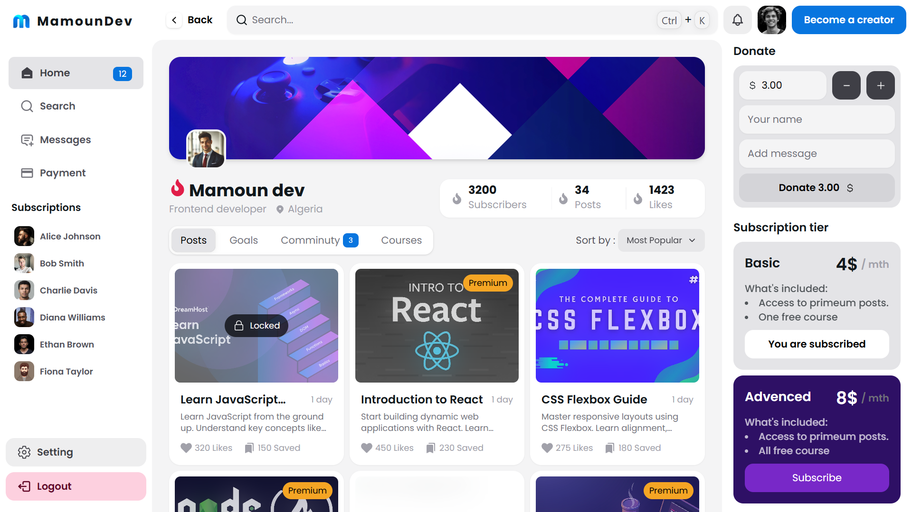
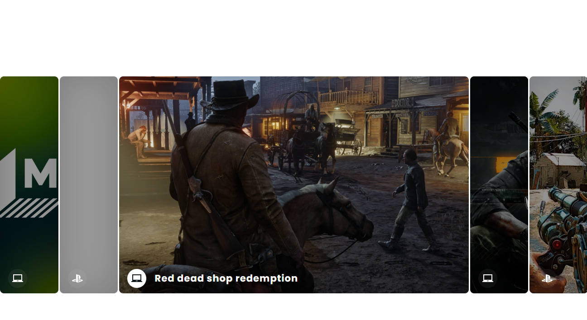
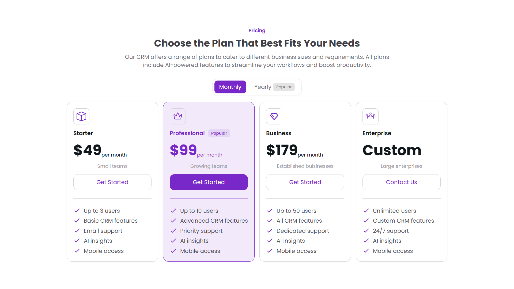
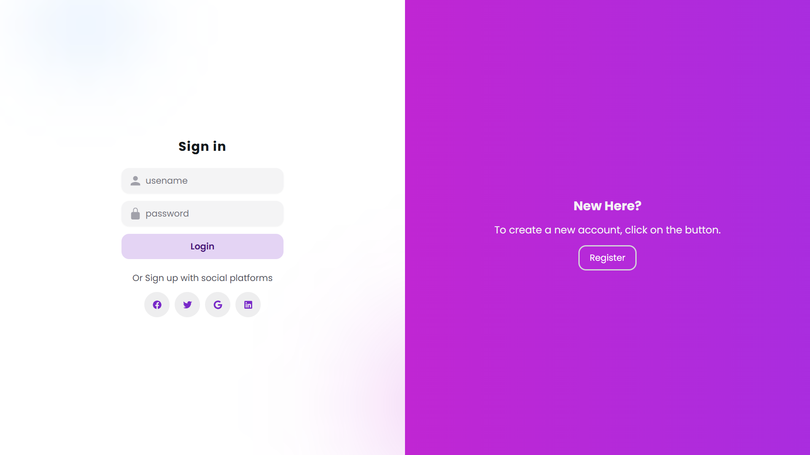

# React UI Components & Animations

A collection of custom-built React UI components, interactive interfaces, creative animations, and modern design experiments. This project serves as a showcase of reusable components and UI concepts built with React and Tailwind CSS.


## 📸 Components Preview

### 📊 Dashboard


### 🖼️ Gallery Animation



### 💳 Pricing Plan


### 🔐 Login Animation



## ✨ Overview

This repository brings together a variety of UI components and interface experiments, focusing on modern design, smooth animations, interactive elements, and reusable frontend development patterns.

Each component explores a different UI concept, from animated authentication screens to dashboards, sliders, galleries, and interactive cards.

## 🎨 Components Showcase

The project includes the following components and interface experiments:

- **Auth Animation** — Animated authentication interface.
- **Landing Page** — Modern landing page design.
- **Dashboard** — Dashboard UI experiment.
- **Instagram Clone** — Social media interface inspired by Instagram.
- **Food App** — Food application interface.
- **Absolute Slider** — Creative slider component.
- **Profile Card Effects** — Profile cards with interactive visual effects.
- **Custom Slider** — Custom-built slider interface.
- **Gallery Animation** — Animated gallery experience.
- **Pricing Plan** — Pricing section UI.
- **Swiper Component** — Slider and carousel experiment.
- **List Animation** — Animated list interactions.

*Some components may be experimental or require further development.*

## 🛠️ Built With

- **React** — Component-based UI development.
- **TypeScript** — Type-safe JavaScript development.
- **Tailwind CSS** — Utility-first styling.
- **CSS Animations** — Visual transitions and interactive effects.

## 🚀 Getting Started

### Prerequisites

Make sure you have Node.js and npm installed.

### Installation

Clone the repository:

```bash
git clone YOUR_REPOSITORY_URL
```

Navigate to the project directory:

```bash
cd YOUR_PROJECT_FOLDER
```

Install dependencies:

```bash
npm install
```

Start the development server:

```bash
npm run dev
```

Open the local URL displayed in your terminal to explore the project.

## 🌓 Features

- Reusable React components.
- Interactive UI elements and animations.
- Modern interface design experiments.
- Multiple interface concepts in one project.
- Dark mode support in the main application.
- Component-based project organization.

## 📁 Project Structure

```text
src/
├── components/
│   ├── auth-animation.tsx
│   ├── landing-page1.tsx
│   ├── absolute-slider.tsx
│   ├── profile-card-effect.tsx
│   ├── slider-custom.tsx
│   ├── gallery-animation.tsx
│   ├── plan.tsx
│   ├── swiper1.tsx
│   └── list-animation.tsx
├── dashboard-one.tsx
├── instagram-clone.tsx
├── food-app.tsx
└── App.tsx
```

*The structure above is illustrative; adjust it to match the actual repository.*

## 💡 Purpose

This project is a playground for exploring frontend development, building reusable React components, experimenting with animations, and improving UI/UX implementation skills.

## 👨‍💻 Author

**Mamoun Ben Abderrahmane**

- GitHub: [@mamoun97](https://github.com/mamoun97)
- Portfolio: [mamoun.dev](https://mamoun.dev)

## 📄 License

Check the repository for licensing information before using or distributing this project.
